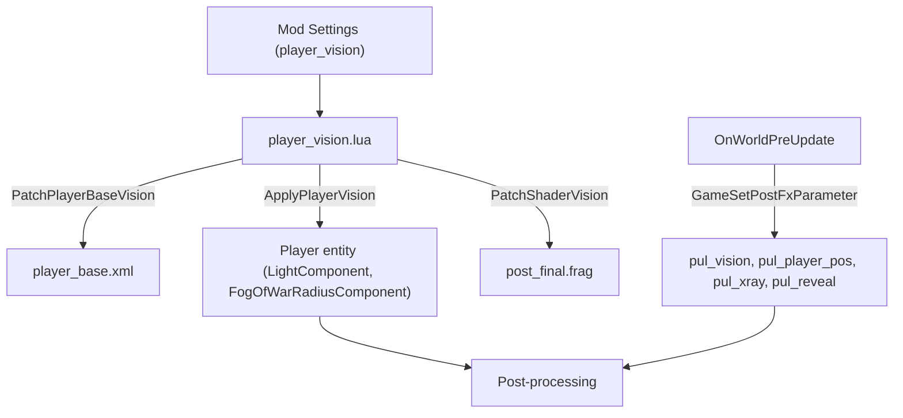

# Vision and Lighting

How the mod limits the player's vision, lets light sources cut through the darkness, and keeps both working with polymorph and the All-Seeing Eye.

## Contents

- [Why Vanilla Components Are Not Enough](#why-vanilla-components-are-not-enough)
- [Overview](#overview)
- [Shader Patch](#shader-patch)
- [Player Entity](#player-entity)
- [Update Loop](#update-loop)
- [Vision Presets](#vision-presets)
- [Polymorph](#polymorph)
- [All-Seeing Eye](#all-seeing-eye)
- [Glowing Materials and Burning Entities](#glowing-materials-and-burning-entities)

## Why Vanilla Components Are Not Enough

Shrinking the player's own light and fog of war radius does not make the underground dark:

- **Hardcoded underground ambient.** `data/shaders/post_final.frag` adds a fixed 35% brightness to every explored underground point:

  ```glsl
  lights += max(0.35 - fog_of_war_sky_ambient_amount, 0.0) * dither_srgb( fog_of_war, noise.b, 128.0 );
  ```

  Even with the player light at zero, explored caves stay 35% visible.
- **Fog of war clearing in the engine.** The engine clears the fog of war around the player within the vanilla radius of 256 pixels regardless of components.
- **Saved exploration.** The fog of war state is stored in the save. After loading, already explored caves have no fog, and the 35% ambient makes them visible without any lantern.
- **Static player light.** The player `LightComponent` in `data/entities/player_base.xml` has `update_properties="0"`, so changing its `radius` at runtime has no effect.

## Overview

The mod combines changes to the player entity with a patch of the final post-processing shader:



## Shader Patch

`PatchShaderVision()` applies four patches from `files/patches/vision/` to `post_final.frag` with the [Diff Patch Library](architecture.md#diff-patch-library).

### Uniforms

`01_uniforms.patch.txt` declares the parameters the mod sends every frame:

- `pul_vision.x`: vision scale, from 1.0 to 0.0.
- `pul_vision.y`: vision radius in world pixels.
- `pul_vision.z`: underground ambient factor, from 1.0 (vanilla) to 0.0 (none).
- `pul_vision.w`: on/off flag. `0.0` returns vanilla rendering, for example on the death screen.
- `pul_player_pos.xy`: player world position.
- `pul_xray`, `pul_reveal`: areas revealed by the All-Seeing Eye. See [All-Seeing Eye](#all-seeing-eye).

### Darkness Around the Player

`02_fog_restriction.patch.txt` adds fog of war by distance from the player, right after the depth factor `fade` is computed (0.0 on the surface, 1.0 deep underground):

```glsl
float pul_dist = distance(world_pos, pul_player_pos.xy);
float pul_light = max(max(light_tex_sample.r, light_tex_sample.g), max(light_tex_sample.b, light_tex_sample.a));
float pul_glow = max(max(glow.r, glow.g), glow.b);
pul_light = max(pul_light, pul_glow * 1.5);
float pul_edge = pul_vision.y > 0.0 ? smoothstep(pul_vision.y * 0.75, pul_vision.y, pul_dist) : 1.0;
float pul_darken = pul_edge * fade * (1.0 - clamp(pul_light * 2.0, 0.0, 1.0));
fog_of_war_amount = clamp(fog_of_war_amount + pul_darken, 0.0, 1.0);
```

- `pul_light` takes the brightness of the light buffer (light color plus the fog of war hole alpha) and of the glow buffer. Wherever a held or thrown lantern, a torch, an explosion or a glowing material lights the area, the darkening drops to zero. This lets fire and glowing materials cut through the darkness far from the player.
- `smoothstep` softens the edge of the vision circle.
- The `pul_vision.y > 0.0` check avoids division by zero in Pitch Black and removes the leftover light spot under the player.

### Underground Ambient

`03_ambient_baseline.patch.txt` scales the vanilla 0.35 ambient by `pul_vision.z`:

```glsl
float pul_ambient_base = 0.35 * (pul_vision.w > 0.5 ? pul_vision.z : 1.0);
lights += max(pul_ambient_base - fog_of_war_sky_ambient_amount, 0.0) * dither_srgb( fog_of_war, noise.b, 128.0 );
```

### Background Leakage

Where the foreground alpha is below one, the vanilla shader shows the background texture, which drew cave silhouettes through the darkness. `04_bg_leakage.patch.txt` darkens the background too:

```glsl
color = mix(color, color * fog_of_war, fade * (1.0 - pul_vision.z));
```

## Player Entity

`player_vision.lua`:

- `PatchPlayerBaseVision()` patches `data/entities/player_base.xml` at startup: sets `update_properties="1"` on the player `LightComponent` and adds a `FogOfWarRadiusComponent` to the root entity.
- `ApplyPlayerVision(player_entity)` sets the light and fog of war radii for the selected preset. In Pitch Black it disables both components.

## Update Loop

- **Every frame** (`OnWorldPreUpdate` → `UpdatePlayerVision()`): sends `pul_vision` and the player position, so the vision circle follows the player smoothly and the shader state can never get stuck.
- **Settings change** (`OnModSettingsChanged` → `UpdatePlayerVision(true)`): reapplies the player components and the shader without restarting the run.
- **Player components** are reapplied only when the setting or the player entity ID changes.
- **Death**: when no player entity exists, `pul_vision.w = 0.0` restores vanilla rendering for the death screen.

## Vision Presets

| Preset | Scale | Player light radius | Fog of war radius | Shader radius | Ambient factor |
| --- | --- | --- | --- | --- | --- |
| Vanilla | 1.0 | 350 px | 256 px | 256 | 1.0 (35%) |
| Dim | 0.75 | 262 px | 192 px | 192 | 0.75 (26%) |
| Dark | 0.5 | 175 px | 128 px | 128 | 0.5 (17.5%) |
| Very Dark | 0.25 | 87 px | 64 px | 64 | 0.25 (8.7%) |
| Minimal | 0.1 | 35 px | 25 px | 25.6 | 0.1 (3.5%) |
| Pitch Black | 0.0 | disabled | disabled | 0 | 0.0 (0%) |

## Polymorph

While polymorphed, the player is a different entity: it has the `polymorphed_player` tag (`polymorphed_cessation` for Cessation) instead of `player_unit`. The vanilla game finds the polymorphed player the same way in `data/scripts/magic/null_room/check.lua`.

An earlier version looked only for `player_unit`. While polymorphed, it turned the shader off, and after returning it did not turn it back on until the settings changed.

The current implementation in `player_vision.lua`:

- **Finding the player.** `FindPlayerEntity` looks for `player_unit`, then for `polymorphed_player` and `polymorphed_cessation`. It returns the entity ID and whether it is polymorphed.
- **Shader every frame.** `ApplyShaderVision(scale)` sends `pul_vision` on every frame.
- **Player components.** `ApplyPlayerVision` runs only for `player_unit`, when the setting or the entity ID (`last_applied_entity`) changes. This covers the return from polymorph whether or not the player gets a new ID.
- **Polymorphed creature.** Only `pul_player_pos` and `pul_vision` are updated; the creature's own `LightComponent` and `FogOfWarRadiusComponent` are left alone. The shader adds darkness on top of the vanilla fog of war, so the limit works even if the creature clears fog with the vanilla radius.
- **Separate setting.** `polymorph_vision` ("Polymorphed vision"): `Same as player` (default, uses `player_vision`) or any vision preset. `MOD_SETTING_SCOPE_RUNTIME`, applies immediately.

The belt lantern is also recreated after polymorph. See [Belt Lantern](holding-and-belt.md#belt-lantern).

## All-Seeing Eye

Both vanilla reveal mechanics work through the fog of war grid:

- The **`X_RAY` spell** fires a stationary projectile, `data/entities/projectiles/deck/xray.xml` (`lifetime="1000"`, about 16.7 seconds). Its `MagicXRayComponent` (`radius="512"`, `steps_per_frame="8"`) gradually clears the fog of war around the cast point.
- The **`REMOVE_FOG_OF_WAR` perk** adds a `GameEffectComponent` to the player, and the engine clears the fog of war on the whole level. Holding Sunseed or Sunstone (`data/entities/items/pickup/sun/`) gives the same effect.

In vanilla, the revealed area becomes visible thanks to the 35% ambient. The mod's shader blocks do not use the fog of war grid: they darken by distance from the player, scale the ambient and darken the background, so the revealed area went dark again.

`files/scripts/all_seeing_eye.lua` fixes this:

- `PatchXRayProjectile()` adds the `pul_xray` tag to the root of `xray.xml`. Mods that reuse the projectile get the tag too.
- `UpdateAllSeeingEye(entity)` runs every frame from `UpdatePlayerVision`, for the player or the polymorphed creature:
  - **Perk:** `GameGetGameEffectCount(entity, "REMOVE_FOG_OF_WAR") > 0` sets `pul_reveal.x = 1.0`.
  - **Spell:** one active circle is sent to the shader as `pul_xray = (x, y, radius, strength)`. A new `pul_xray` entity starts a circle at the cast point.
    - The radius grows by 8/3 px per frame (three times slower than `steps_per_frame="8"`) up to 512 px.
    - Once the strength is full and the circle covers the screen (`GameGetCameraBounds`, falling back to the virtual resolution 427×242) or reaches the maximum radius, the strength fades to 0 over 10 seconds (600 frames).
    - The circle lives until the fade ends, even if the projectile is gone.
  - **Repeated cast:** if a circle is still active, the new one takes over its radius and strength and then rises to full strength over 1 second (60 frames). Rapid casting does not make the screen flicker.

The shader combines both into `pul_reveal_amount` (0.0 to 1.0, with a soft circle edge). It removes the distance darkening, restores the vanilla ambient (`mix(pul_vision.z, 1.0, pul_reveal_amount)`) and turns off the background darkening. Inside the revealed area, visibility matches vanilla.

Only one spell circle exists at a time: casting again elsewhere moves the revealed area.

## Glowing Materials and Burning Entities

In vanilla, many burning and molten materials have no `gfx_glow` (`flame`, `fire_blue`, `burning_powder`) or a weak one (`liquid_fire` 200, `acid` 100, `lava` 150). Under limited vision, burning oil and fire stayed dim or invisible outside the vision circle. `patch_materials.lua` fixes this in three ways.

### Material Glow

`PatchMaterialsGlow()` raises `gfx_glow` in `data/materials.xml`:

| Group | Materials and glow |
| --- | --- |
| Fire | `flame` 400, `fire` 500, `fire_blue` 400, `liquid_fire` 450, `liquid_fire_weak` 300, `burning_powder` 350 |
| Molten | `lava` 450; `gold_molten`, `metal_molten`, `steel_molten`, `copper_molten`, `brass_molten`, `silver_molten`, `aluminium_molten` 400; `glass_molten` 350 |
| Acid, radioactive, plasma | `radioactive_liquid` 180, `acid` 200, `plasma_fading`, `plasma_fading_green`, `plasma_fading_pink` 400, `plasma_fading_bright` 600 |
| Sparks | `spark` 300; colored sparks 150–255 |

### Burning Entity Light

`PatchBurningEntity()` adds a light to `data/entities/misc/effect_on_fire.xml`, the effect attached to anything that catches fire:

```xml
<LightComponent
    _enabled="1"
    r="255"
    g="140"
    b="40"
    radius="180"
    fade_out_time="1.0"
    update_properties="1" >
</LightComponent>
```

The effect entity follows its host, so a burning enemy or player lights the cave within 180 px, and the light fades over 1 second when the fire goes out.

### Wider Glow Blur

`PatchGlowShaders()` applies `files/patches/glow/` to the glow blur shaders:

- The blur radius in `post_glow1.frag` (horizontal) and `post_glow2.frag` (vertical) grows from 5.0 to 10.0 pixels (`BLUR_RADIUS`), widening the halo around fire, lava and sparks.
- In `post_glow1.frag`, the normalization changes from `0.1` to `0.05` (21 samples instead of 11), so the glow does not get brighter.
- In `post_glow2.frag`, the decay factor changes from `1.0 / 12.2` to `1.0 / 23.0`, keeping the vanilla glow decay rate without white build-up.
