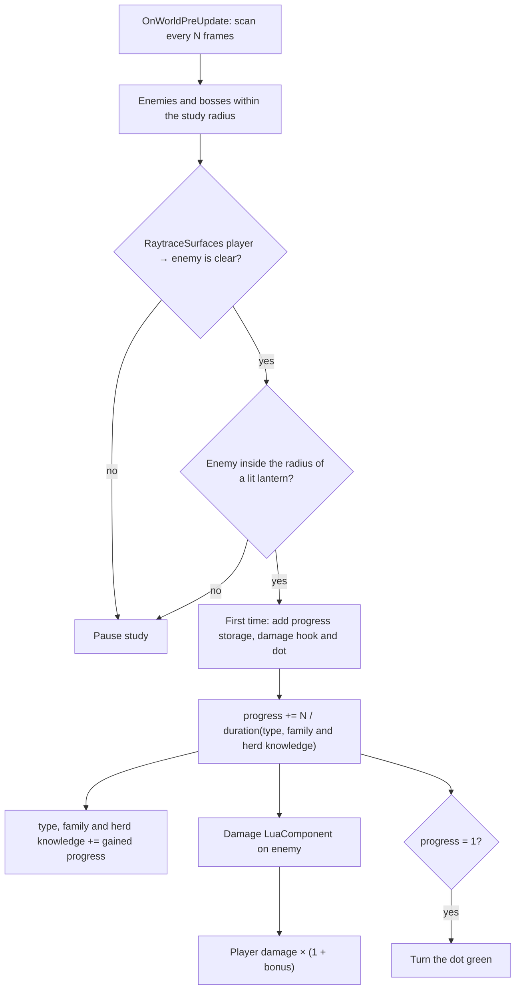

# Enemy Study: Damage Bonus Against Observed Enemies

[← Back to R&D Index](../rnd.md)

Research on the "Enemy study" mechanic planned for version 0.3 (see [version-0.3.md](../versions/version-0.3.md#strategic-world-incentives)): the player grows a damage bonus against enemies by watching them in the light, and studies each enemy type faster the better they already know it and its relatives.

- [Requirements](#requirements)
- [Approach Overview](#approach-overview)
- [Mod Settings](#mod-settings)
- [Finding Candidate Enemies](#finding-candidate-enemies)
- [Enemy Type and Bosses](#enemy-type-and-bosses)
- [Line of Sight](#line-of-sight)
- [Lit Area Check](#lit-area-check)
- [Study Progress](#study-progress)
- [Applying the Damage Bonus](#applying-the-damage-bonus)
- [Study Markers](#study-markers)
- [Performance](#performance)
- [Edge Cases](#edge-cases)
- [Relevant Game Files](#relevant-game-files)
- [Implementation](#implementation)

## Requirements

- The mechanic is enabled by a separate Mod Settings option, off by default and not part of any preset.
- An enemy instance is studied only while all conditions hold:
  - it is within the study radius around the player;
  - it is in direct line of sight of the player (raycast);
  - it stands within the light radius of a lantern in the world or in the player's hands. The belt lantern does not count.
- The player studies an enemy type through its instances. Each instance has its own study progress from 0 to 1, and its speed depends on the knowledge of its type and its relatives:
  - the knowledge of a type is the sum of the study progress of all its instances, including partly studied ones: five fully studied instances give 5, two half-studied ones give 1;
  - related enemies share part of their knowledge: other variants of the same enemy give half of theirs, the rest of its herd a fifth (see [Related Enemies](#related-enemies));
  - the base study duration is set in Mod Settings (3, 5, 10 or 30 seconds, 10 by default) and applies at knowledge 0;
  - as the knowledge grows from 0 to 10, the duration shrinks linearly from the base duration to 0.5 seconds, and stays at 0.5 seconds above 10;
  - bosses take 120 seconds and neither give nor get knowledge.
- The player's damage against an instance grows linearly with its study progress, from 0% to the configured bonus (10%, 25%, 50% or 100%).
- The accumulated bonus of an instance is kept after it leaves the light, the line of sight or the study radius. Study simply pauses and resumes from the same value.
- An instance whose study has begun has a small semi-transparent dot above its head: yellow while it is being studied, red while its study is paused (out of light, sight or the study radius), green once it is fully studied.

## Approach Overview

The engine offers no ready-made "observed enemy" concept, so the mechanic is assembled from separate API calls. A periodic scan from `OnWorldPreUpdate` checks nearby enemies and advances study on each instance; the knowledge of each type, family and herd is kept in run globals; a Lua hook on the enemy applies the bonus when the player damages it.



## Mod Settings

The options have their own `Enemy Study` category in Mod Settings, after `Gameplay`.

- `enemy_study` — boolean, default `false`. Turns the whole mechanic on and off. With the option off, the scan does not run and the damage hook returns damage unchanged, so enemies studied earlier lose their bonus while it is off.
- `enemy_study_damage_bonus` — enum `0.1` / `0.25` / `0.5` / `1.0` (10%, 25%, 50%, 100%), default `0.25`. The bonus of a fully studied instance. The hook reads it at hit time, so a change applies immediately, including to instances studied earlier.
- `enemy_study_duration` — enum `3` / `5` / `10` / `30` seconds, default `10`. The study duration at knowledge 0. It is read every scan, so a change applies immediately, including to instances under study.
- All options use the runtime scope: they do not affect world generation.
- Presets must ignore all of them. In `settings.lua`, `ApplyPreset` writes every option returned by `GetOptionSettings()` (unlisted ones get their defaults), and `SyncPreset` compares every option to the preset. Without an exclusion, selecting a preset would turn Enemy Study off, and turning it on would switch the preset to `Custom`. A per-setting flag (e.g. `preset_excluded = true`) checked in `GetOptionSettings()` for preset purposes is the simplest fix.

## Finding Candidate Enemies

- Study radius: about one screen width (~400 px) around the player. An enemy outside the screen cannot be meaningfully "watched".
- Ordinary enemies have the `enemy` tag (`data/entities/base_enemy_basic.xml`): `EntityGetInRadiusWithTag(player_x, player_y, radius, "enemy")`.
- Several bosses do not have the `enemy` tag: `boss_alchemist.xml` (High Alchemist), `boss_wizard.xml` (Master of Masters) and `islandspirit.xml`. A second query with the `boss` tag is needed, then the two lists are merged without duplicates.
- Target position is the hitbox centre: `EntityGetFirstHitboxCenter(enemy_id)`. It falls back to the entity position when there is no hitbox.
- Skip dead entities (`EntityGetIsAlive`).

## Enemy Type and Bosses

### Type Key

- `EntityGetFilename(entity_id)` returns the XML file the entity was loaded from (e.g. `data/entities/animals/zombie.xml`). It is the most precise type key: variants with their own files (e.g. a weak and a normal zombie) are separate types. The function is not declared in the local `noita_api.lua`, but vanilla uses it to revive enemies from their file (`data/scripts/status_effects/necrobot.lua`).
- Fallback: `EntityGetName(entity_id)` (e.g. `$animal_zombie`). Variants that share a name would share a type. This is acceptable, but slightly less precise.
- Enemies added by other mods work the same way: their file path is their type key.

### Per-Type Knowledge

- The knowledge of each type is stored in run globals as a fractional number: `GlobalsSetValue("pul_study_knowledge_" .. type_key, tostring(knowledge))`. Each scan adds the progress an instance has just gained, so partly studied instances count too. Globals are saved with the run and reset in a new game, matching "the player studies a type".
- Run globals are preferred over a `VariableStorageComponent` on the player: polymorph replaces the player entity (see [Player Polymorph and Lighting System](polymorph-and-lighting.md)).
- Instance duration: `B − (B − 30) × min(1, knowledge / 10)` frames, where `B` is the base duration from the settings (600 frames, 10 s by default) and 30 frames (0.5 s) is the duration at knowledge 10 and above, where `knowledge` is the effective knowledge described in [Related Enemies](#related-enemies).
- The duration is recalculated every scan from the current knowledge, so the study of an instance speeds up while the knowledge grows, including from the instance itself and from other instances studied in parallel.

### Related Enemies

Studying an enemy also teaches the player about its relatives. Two levels of relation are detected at runtime, so they work for enemies added by other mods too:

| Level | Key | Example | Weight |
| --- | --- | --- | --- |
| Type | File path from `EntityGetFilename` | `zombie_weak.xml` | 1 |
| Family | File path without variant suffixes | `zombie` covers `zombie.xml` and `zombie_weak.xml` | 0.5 |
| Herd | `herd_id` of `GenomeDataComponent`, via `HerdIdToString` | `orcs` covers all Hiisi | 0.2 |

- Variant suffixes, stripped repeatedly: `_weak`, `_big`, `_small`, `_tiny`, `_giga`, `_large`, `_super`, `_hell`, `_fire`, `_chef`, `_santa`, `_a`, `_b`. In vanilla this gives families such as `miner` (6 variants), `fungus` (4), `shotgunner` (3), `worm` (3), `phantom` (`phantom_a`, `phantom_b`), `necromancer`, `thundermage`, `roboguard`, `tank`. No unrelated enemies are merged.
- Each level has its own run global: `pul_study_knowledge_<type>`, `pul_study_family_knowledge_<family>`, `pul_study_herd_knowledge_<herd>`. Every gain of study progress is added to all three.
- Effective knowledge: `T + 0.5 × max(0, F − T) + 0.2 × max(0, H − F)`, where `T`, `F` and `H` are the type, family and herd knowledge. Each level excludes the level below, so the enemy's own type is not counted twice. `max(0, …)` guards families whose variants belong to different herds.
- Example: after 5 fully studied zombies, a weak zombie starts at knowledge 2.5 and a big zombie (same herd, other family) at 1.
- Vanilla herds are coarse: `orcs` (25 types: Hiisi), `mage` (24), `ghost` (21: spirits, phantoms, mimics, crystals), `robot` (18), `slimes` (15: slimes, frogs, shooters, tentaclers). The small herd weight keeps such loose groups from giving much.
- The `player` herd is ignored: charmed enemies and the player's allies say nothing about the enemy itself.
- Bosses neither give nor get knowledge: they always take 120 s and their progress is not added to any level.

### Bosses

- A boss is an entity with the `boss` tag. The Dragon (`boss_dragon.xml`, Suomuhauki) has no `boss` tag, only `boss_dragon`, so it must be added explicitly.
- Bosses always take 7200 frames (120 s). They neither add to nor use any knowledge (type, family or herd), since each boss normally appears once per run.
- Multi-part bosses (e.g. `boss_centipede.xml`, Kolmisilmä) take damage on the main entity. The minions and helper entities (`boss_centipede_minion`, `boss_ghost_helper`) are not bosses and do not have the `boss` tag.

## Line of Sight

- `RaytraceSurfaces(x1, y1, x2, y2)` stops on solid cells and ignores liquids, gases and fire. It returns `did_hit, hit_x, hit_y`: `did_hit == false` means a clear line.
- Ray start: the player's hitbox centre (`EntityGetFirstHitboxCenter(player_id)`), not the feet, to avoid hitting the floor the player stands on.
- `RaytraceSurfacesAndLiquiform` would also stop on liquids. `RaytraceSurfaces` is closer to how the player actually sees through liquids.
- One ray per enemy per scan. The CPU cost of Lua raytracing is acceptable at this rate (see [CPU-Side Alternative](line-of-sight-and-shaders.md#cpu-side-alternative-lua-raytracing)).

## Lit Area Check

The Noita API has no function that returns the light level at a world point, and the final image with the mod's darkness overlay exists only on the GPU (see [Limited Player Vision and Darkness](player-vision-and-darkness.md)). The enemy is therefore lit if its hitbox centre is within the light radius of a lantern. No rays are cast from lanterns: a lantern behind a thin wall still lights the enemy. This is an accepted simplification.

### Light Sources

| Source | Counts | How to find |
| --- | --- | --- |
| Lantern in the world (hanging, lying, thrown) | Yes | `EntityGetWithTag("lantern")` with an enabled `LightComponent` |
| Lantern in the player's hands | Yes | Same query: `LightComponent` is enabled in hand (`enabled_in_hand`) |
| Lantern in the inventory | No | Its `LightComponent` is disabled: `ComponentGetIsEnabled` is false |
| Belt lantern | No | It is a separate `pul_belt` entity without the `lantern` tag, so the query skips it |
| Extinguished lantern | No | `IsLanternExtinguished(entity_id)` |
| Player's own vision light, burning creatures, glowing materials | No | Not queried |

- Radius: the current `radius` of the lantern's `LightComponent`. It already includes the illumination setting, quality tier, liquid state and the per-frame changes of modifiers (flickering, fading), which `GetLanternAppliedLightRadius` from `lantern_illumination.lua` does not.
- **[Needs verification]** `LightComponent.radius` is the outer radius of the light sprite with a soft falloff. The visibly lit area is smaller. An "effective radius" factor (e.g. ×0.6) should be calibrated in-game so that an enemy counts as lit only where the player actually sees it lit.
- The player's own light is excluded on purpose. With vanilla vision every enemy near the player would be lit, and the mechanic would lose its link to lanterns.
- Lantern positions and radii are gathered once per scan. Each enemy is then checked by squared distance, which is cheap.

## Study Progress

State lives on the enemy instance in `VariableStorageComponent`s, in the same way as lantern traits (see [Lantern Progression](lantern-progression.md#tier-and-modifier-roll)). It is saved with the enemy when its chunk unloads or the game is saved.

| Storage | Meaning |
| --- | --- |
| `pul_study_progress` | Study progress from 0 to 1; its presence means the study has begun |
| `pul_study_done` | Set when the progress reaches 1; skips the instance in later scans and selects the green dot |

- Each scan with all conditions true adds `N / duration` to `pul_study_progress`, capped at 1, and adds the same gain to the type, family and herd knowledge (except for bosses).
- Bonus: `bonus = enemy_study_damage_bonus × pul_study_progress`.
- The value never decreases. Leaving the light, the line of sight or the radius only stops growth.
- A scan period of 10 frames gives 3 steps over the shortest 0.5-second study and 60 steps over the default 10-second base study.

## Applying the Damage Bonus

The bonus must affect only damage dealt by the player, so a per-enemy multiplier that ignores the attacker is not enough.

### Option A: `script_damage_about_to_be_received` (Preferred)

- A `LuaComponent` with `script_damage_about_to_be_received` is added to the enemy the first time it is studied. Its script defines:

```lua
function damage_about_to_be_received(damage, x, y, entity_thats_responsible, critical_hit_chance)
    -- if Enemy Study is on and the responsible entity is the player:
    -- return damage * (1 + bonus), critical_hit_chance
    return damage, critical_hit_chance
end
```

- The returned values replace the incoming damage before it is applied, so the bonus works with any damage type and is shown correctly in damage numbers.
- No vanilla entity uses this field. The only vanilla script with this signature (`data/scripts/perks/ingest_projectiles.lua`) belongs to a commented-out perk that registers it through `script_damage_received`. The hook has been confirmed in-game: it is called for a `LuaComponent` added at runtime with `execute_every_n_frame = -1`, and the returned damage replaces the incoming one.

### Option B: `script_damage_received` + `EntityInflictDamage` (Fallback)

- The `damage_received(damage, message, entity_thats_responsible, is_fatal, projectile_thats_responsible)` hook is reliably supported. It reacts after the damage and inflicts the extra part: `EntityInflictDamage(enemy_id, damage * bonus, ...)`.
- Drawbacks: a second damage number and a second hit sound, the extra damage is dealt with a different damage type than the original one (resistances may not match), and recursion has to be guarded: the extra damage triggers the hook again. Pass `entity_who_is_responsible = 0` or set a flag to avoid that.
- Skip the extra hit when `is_fatal` is true.

### Rejected: `DamageModelComponent.damage_multipliers`

- Raising the enemy's multipliers would make it take more damage from every source, including other enemies, falling and the environment. This contradicts the "player's damage" requirement.

### Identifying the Player as the Damage Source

- Projectiles from wands report the shooter (`ProjectileComponent.mWhoShot`) as the responsible entity, so spells, explosions and most wand damage are covered.
- Compare against the current player entity at hit time (tag `player_unit`), not a cached ID: polymorph replaces the player entity. Polymorphed players have the `polymorphed_player` tag.
- **[Needs verification]** Damage over time (fire, toxic, bleeding), kicks and thrown lantern impacts may report no responsible entity (`0`). Such damage would not get the bonus. This is acceptable, but should be confirmed.

## Study Markers

A dot above the enemy's head shows its study state: yellow while the instance is being studied in the current scan, red while its study is paused, green once it is fully studied.

Vanilla has a direct precedent: `data/entities/misc/sentry_target.xml` is a child entity with an emissive `SpriteComponent` that follows its parent through `InheritTransformComponent only_position="1"` with a `Transform` offset.

- A mod entity `study_marker.xml` (name and tag `pul_study_marker`) with three `SpriteComponent`s: a yellow dot (tag `pul_study_in_progress`, enabled), a red dot (tag `pul_study_paused`, `_enabled="0"`) and a green dot (tag `pul_study_done`, `_enabled="0"`). The images are round dots (4×4 px with transparent corners), drawn at half of their size through `special_scale_x`/`special_scale_y` set from Lua, `alpha="0.5"`, `emissive="1"` so they stay visible in darkness. Plus `InheritTransformComponent only_position="1"`.
- The marker is loaded with `EntityLoad` and attached with `EntityAddChild(enemy_id, marker_id)` when study of the instance begins, i.e. in the same scan that adds `pul_study_progress`.
- `EntitySetComponentIsEnabled` shows the sprite of the current state and hides the other two. Toggling components avoids changing `image_file` at runtime, which would also require `EntityRefreshSprite`.
- The marker is found among the enemy's children (`EntityGetAllChildren`) by its tag, so a reload never attaches a second one. Its colour is restored from `pul_study_done`.
- Height above the head: the top of the enemy's hitbox. Read the smallest `aabb_min_y` across its `HitboxComponent`s and add a few pixels of margin. Set the result as the `Transform` offset, or as the sprite's `offset_y`. Large bosses need the same calculation; a fixed offset would not fit them.
- `only_position="1"` keeps the marker upright when the enemy flips or rotates.
- The marker is removed together with the enemy, since child entities are destroyed with their parent.
- With Enemy Study turned off, all loaded markers are hidden during the next scan.
- The sprite offset is in image pixels and is scaled together with the sprite, so the height is divided by the scale (`offset_y = 2 + height × 2` at half size). Confirmed in-game: the dot is drawn just above the enemy's head.
- **[Needs verification]** Whether `emissive="1"` sprites are hidden by the mod's darkness overlay in `post_final.frag` at Pitch Black. If they are, the marker needs a different rendering approach.

## Performance

Per scan (every 10 frames):

- 2 `EntityGetInRadiusWithTag` calls (`enemy` and `boss`) and 1 pass over lanterns.
- For each candidate enemy: a distance check against each lantern and 1 player → enemy ray. The ray is cast only when the enemy is lit, which is the cheaper check.

With typical counts (5–15 enemies on screen, 1–5 lanterns nearby) this is at most a dozen or so raytraces per scan. Fully studied instances keep their bonus and are skipped by the scan entirely.

## Edge Cases

- **Invisible enemies** (e.g. with the `INVISIBILITY` effect): probably should not be studied. Check via `GameGetGameEffectCount(enemy_id, "INVISIBILITY")`.
- **Enemies that split or spawn others** (e.g. slimes): new entities start with zero progress, but their type may already be known, so their study is shorter.
- **Charmed enemies**: they keep their progress. The bonus only matters if the player attacks them.
- **Polymorphed enemies**: a polymorphed creature is a new entity of another type, so the progress of the instance is lost. Probably acceptable.
- **The player has no lit lanterns nearby**: no study. This matches the intent.

## Relevant Game Files

- `data/entities/base_enemy_basic.xml` — `enemy` tag, `HitboxComponent` and `DamageModelComponent` of standard enemies.
- `data/entities/animals/boss_*/` — boss entities and their tags (`boss`, `boss_dragon`).
- `data/entities/misc/sentry_target.xml` — vanilla example of a sprite marker attached to a creature.
- `data/scripts/perks/ingest_projectiles.lua` — the only vanilla script with the `damage_about_to_be_received` signature (unused).
- `files/scripts/lantern_illumination.lua` — `GetLanternAppliedLightRadius` for lantern light radius.
- `settings.lua` — preset logic (`ApplyPreset`, `SyncPreset`, `GetOptionSettings`).

## Implementation

The mechanic is implemented in the mod as follows:

| File | Role |
| --- | --- |
| `files/scripts/enemy_study.lua` | Scan, lit area and line of sight checks, study progress, type, family and herd knowledge, markers. `UpdateEnemyStudy()` is called from `OnWorldPreUpdate` |
| `files/scripts/enemy_study_damage.lua` | `damage_about_to_be_received` hook (Option A), added to an enemy when its study begins |
| `files/entities/study_marker.xml` | Marker entity with the yellow, red and green dot sprites |
| `files/ui_gfx/study_dot_yellow.png`, `study_dot_red.png`, `study_dot_green.png` | Dot images |
| `settings.lua` | `Enemy Study` category with the `enemy_study`, `enemy_study_damage_bonus` and `enemy_study_duration` options, marked `preset_excluded = true`; `GetPresetSettings()` skips them in `ApplyPreset` and `SyncPreset` |
| `files/scripts/utils.lua` | `FindVariableStorage()` reads study storage without adding components to enemies that were never studied |

- Marker colours are synced for every loaded marker at the end of each scan: green for a fully studied enemy, yellow for an enemy studied in this scan, red for all others. Turning the option off hides all loaded markers.
- Child entities with an enemy tag (parts of other entities) are skipped; only root entities are studied.
- Confirmed in-game: the scan, the damage hook (Option A), the type, family and herd knowledge, the settings and the markers work, with no errors in the log.
- Still worth checking during play: the `LIT_RADIUS_FACTOR` of `0.6`, the marker height on large enemies and bosses, and marker visibility at Pitch Black.
