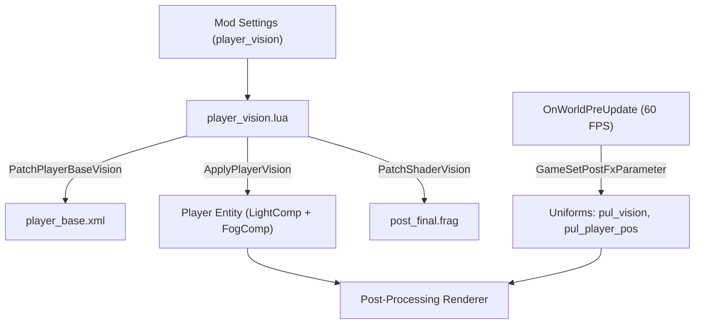

# Limited Player Vision and Darkness

[← Back to R&D Index](../rnd.md)

Technical research and implementation overview of the Limited Player Vision system, overcoming vanilla Noita engine limitations, and creating the absolute darkness (Pitch Black 0%) mode in the **Pick Up Your Lantern** mod.

## Vanilla Engine Limitations and Technical Challenges

In vanilla Noita, the player possesses an extraordinarily large base field of view even in the darkest underground biomes. Attempting to limit visibility solely via standard entity components encounters three hard engine barriers:

### Hardcoded Underground Ambient Light (Ambient 35%)

In the final post-processing shader `data/shaders/post_final.frag` (line 410), the following formula is hardcoded:

```glsl
lights += max(0.35 - fog_of_war_sky_ambient_amount, 0.0) * dither_srgb( fog_of_war, noise.b, 128.0 );
```

Every previously explored point of the underground world (`fog_of_war > 0`, where `world_pos.y > 250.0`) automatically receives a fixed base brightness of **0.35 (35%)**. Even if the radius of the player's own light source is reduced to zero, the cave remains visible at 35%, making it impossible to create a genuine sense of darkness.

### Hardware Fog Clearing in the C++ Engine

The `FogOfWarRadiusSystem` and the player's internal update loop in `noita.exe` are hardcoded to the vanilla clearing radius of $256$ pixels (`VANILLA_FOG_RADIUS = 256`). Even without components or with reduced radii, the engine at a low level clears the fog grid across a considerable distance.

### Permanence of Explored Areas in Save Files

The Fog of War state is persisted into the game save data (`save00/world/` or other active save slots, such as `save03`). When the player loads a saved game, previously explored caves already have zero fog (`fog_value.r = 0.0`), and due to the 35% ambient light, the entire level becomes fully visible without needing any lantern.

### Static LightComponent by Default

In `data/entities/player_base.xml`, the light component has its property update flag disabled (`update_properties="0"`). Unless set to `update_properties="1"`, any runtime calls to `ComponentSetValue2(light_comp, "radius", ...)` are completely ignored by Noita's internal sprite renderer.

## Combined Solution Architecture

To provide correct visibility both in a new game and across loaded save files, a multi-tiered approach is employed: combining the configuration of the player entity's ECS components with modifications to the final post-processing shader `post_final.frag`.



## Shader Modification (post_final.frag)

During mod initialization (`init.lua`), the `PatchShaderVision()` function reads `data/shaders/post_final.frag` and injects 4 logical blocks. For detailed background on Noita's shader pipeline and fog grid, see [Fog of War Line-of-Sight and Shaders](line-of-sight-and-shaders.md).

### Uniform Declarations

The shader accepts two dynamic 4-component vectors:

```glsl
varying vec2 tex_coord_fogofwar;
uniform vec4 pul_vision;
uniform vec4 pul_player_pos;
```

* `pul_vision.x`: selected vision scale (from $1.0$ down to $0.0$).
* `pul_vision.y`: dynamic fog radius in world pixels.
* `pul_vision.z`: underground ambient light factor ($1.0$ vanilla $\rightarrow$ $0.0$ complete darkness).
* `pul_vision.w`: activation flag ($1.0$ — mod active, $0.0$ — revert to vanilla, e.g., upon player death).
* `pul_player_pos.xy`: exact player world coordinates $(p_x, p_y)$, updated every frame.
* `pul_xray`, `pul_reveal`: areas revealed by the All-Seeing Eye spell and perk. See details in [All-Seeing Eye Spell and Perk](#all-seeing-eye-spell-and-perk).

### Dynamic Fog of War Overlay

Immediately after computing the depth coefficient `fade` (where $fade = 0.0$ on the surface at $Y \le 250$ and $fade = 1.0$ deep underground):

```glsl
if (pul_vision.w > 0.5)
{
    float pul_dist = distance(world_pos, pul_player_pos.xy);
    float pul_light = max(max(light_tex_sample.r, light_tex_sample.g), max(light_tex_sample.b, light_tex_sample.a));
    float pul_glow = max(max(glow.r, glow.g), glow.b);
    pul_light = max(pul_light, pul_glow * 1.5);
    float pul_edge = pul_vision.y > 0.0 ? smoothstep(pul_vision.y * 0.75, pul_vision.y, pul_dist) : 1.0;
    float pul_darken = pul_edge * fade * (1.0 - clamp(pul_light * 2.0, 0.0, 1.0));
    fog_of_war_amount = clamp(fog_of_war_amount + pul_darken, 0.0, 1.0);
}
```

* **Distance to player**: `distance(world_pos, pul_player_pos.xy)` computes the exact distance from the screen fragment to the character.
* **Punching through fog with light and glow**: `pul_light` samples brightness from `light_tex_sample` (RGB light + alpha channel of fog holes) and the glow buffer `glow` (`pul_glow`). If an area is illuminated by a held lantern, thrown lantern, torch, explosion, or emissive materials (fire, burning oil, lava, acid), the multiplier $(1.0 - \text{clamp}(pul\_light \times 2.0, 0.0, 1.0))$ zeroes out darkening. This allows fire and material glow to cut through darkness even far away from the player.
* **Smooth edge transition**: `smoothstep(pul_vision.y * 0.75, pul_vision.y, pul_dist)` ensures a soft falloff of light at the boundary of the vision radius.
* **Pitch Black (zero radius)**: the `pul_vision.y > 0.0 ? ... : 1.0` check avoids division by zero in GLSL when the radius is $0$, completely eliminating any residual light spot under the player's feet.

### Underground Ambient Scaling

Vanilla ambient light addition of $0.35$ is modulated by the `pul_vision.z` multiplier:

```glsl
float pul_ambient_base = 0.35 * (pul_vision.w > 0.5 ? pul_vision.z : 1.0);
lights += max(pul_ambient_base - fog_of_war_sky_ambient_amount, 0.0) * dither_srgb( fog_of_war, noise.b, 128.0 );
```

In Pitch Black mode, `pul_vision.z = 0.0`, completely eliminating underground ambient lighting in unlit areas.

### Preventing Background Leakage

In underground caverns where the foreground alpha channel is less than one (`color_fg.a < 1.0`), the vanilla shader renders the background texture `tex_bg`. In darkness, this revealed visible cave silhouettes through black fog. An additional block darkens the background:

```glsl
if (pul_vision.w > 0.5)
{
    color = mix(color, color * fog_of_war, fade * (1.0 - pul_vision.z));
}
```

## Player Entity Management (ECS)

Component management for the character is implemented in [player_vision.lua](../../pick_up_your_lantern/files/scripts/player_vision.lua):

1. **`PatchPlayerBaseVision()`**:
   * Patches `data/entities/player_base.xml` on game launch.
   * Sets `update_properties="1"` on the player's `LightComponent`.
   * Injects `FogOfWarRadiusComponent` directly into the entity's root node.
2. **`ApplyPlayerVision(player_entity)`**:
   * Applies calculated radii to components via `ComponentSetValue2`.
   * When Pitch Black ($0\%$) is selected, disables light and fog components entirely via `EntitySetComponentIsEnabled(player_entity, comp, false)`.
   * Passes updated parameters to the shader via `GameSetPostFxParameter("pul_vision", ...)`.

## Lifecycle and State Coordination

The distribution of functions balances optimization needs with event responsiveness:

* **Per-frame loop (`OnWorldPreUpdate`)**:
  Calls `UpdatePlayerVision()`. Passes current player coordinates to the shader via `GameSetPostFxParameter("pul_player_pos", px, py, 0, 0)`. As a result, the vision circle tracks the player smoothly at 60 FPS with zero latency.
* **Settings change (`OnModSettingsChanged`)**:
  When scale settings are modified in the pause menu, the event triggers `UpdatePlayerVision(true)`, instantly reconfiguring entity components and shader uniforms without requiring a run restart.
* **Character death**:
  If the player entity list is empty (death), `UpdatePlayerVision` sets `pul_vision.w = 0.0`, restoring vanilla visibility for the death screen.

## Calibration Preset Table

| Preset | `scale` Value | `LightComponent` Radius | `FogOfWarRadiusComponent` Radius | Shader Radius `pul_vision.y` | Light Multiplier `pul_vision.z` | Characteristics |
| :--- | :--- | :--- | :--- | :--- | :--- | :--- |
| **Vanilla** | `1.0` | $350$ px | $256$ px | $256.0$ | $1.0$ (35% base) | Vanilla behavior with no restrictions |
| **Dim** | `0.75` | $262$ px | $192$ px | $192.0$ | $0.75$ (26% base) | Subtle darkening, comfortable exploration |
| **Dark** | `0.5` | $175$ px | $128$ px | $128.0$ | $0.50$ (17.5% base) | Noticeable narrowing, lantern provides substantial advantage |
| **Very Dark** | `0.25` | $87$ px | $64$ px | $64.0$ | $0.25$ (8.7% base) | Heavy darkness, vision limited to close range |
| **Minimal** | `0.1` | $35$ px | $25$ px | $25.6$ | $0.10$ (3.5% base) | Minimal light around the character's feet/silhouette |
| **Pitch Black** | `0.0` | $0$ px (disabled) | $0$ px (disabled) | $0.0$ | $0.0$ (0% base) | Absolute darkness, zero visibility without light sources |

## All-Seeing Eye Spell and Perk

### Root Cause of the Issue

Both vanilla revelation mechanics operate through the Fog of War grid (`tex_fog`):

* **The `X_RAY` spell** casts a static projectile `data/entities/projectiles/deck/xray.xml` (`lifetime="1000"`, approximately 16.7 s). Its `MagicXRayComponent radius="512" steps_per_frame="8"` progressively clears the fog grid around the cast position.
* **The `REMOVE_FOG_OF_WAR` perk** grants the player a `GameEffectComponent` with the same effect. The engine sets `mFogOfWarOpenEverywhere`, and fog disappears across the entire level. The same effect is provided by holding a Sunseed or Sunstone (`data/entities/items/pickup/sun/`).

In vanilla, the revealed area becomes visible due to the 35% underground ambient light. The mod's shader blocks do not depend on `tex_fog`. Instead, they overlay fog based on distance from the player, scale ambient light by `pul_vision.z`, and darken the background. Consequently, the revealed area was darkened again.

### Implementation

Handled in [all_seeing_eye.lua](../../pick_up_your_lantern/files/scripts/all_seeing_eye.lua):

* `PatchXRayProjectile()` adds the `pul_xray` tag to the root entity in `xray.xml`. Any mods reusing this projectile also inherit the tag.
* `UpdateAllSeeingEye(entity)` is called every frame from `UpdatePlayerVision` for the player entity or polymorphed creature (see [Player Polymorph and Lighting System](polymorph-and-lighting.md)):
  * Perk: `GameGetGameEffectCount(entity, "REMOVE_FOG_OF_WAR") > 0` → `pul_reveal.x = 1.0`;
  * Spell: a single circle is active and passed to the shader as `pul_xray = (x, y, radius, strength)`. A new entity tagged with `pul_xray` creates a circle centered at the cast location:
    * Radius expands by $8/3$ px per frame (three times slower than `steps_per_frame="8"`) up to $512$ px;
    * Once strength is full and the circle covers the whole screen (`GameGetCameraBounds`, with a fallback to virtual resolution $427 \times 242$) or reaches maximum radius, reveal strength fades to $0$ over $10$ s ($600$ frames), returning to standard vision levels;
    * The circle persists until fading finishes, even if the projectile entity has already disappeared.
  * Recasting: if a previous circle is still active, the new one adopts its radius and strength, and then strength ramps up to full over $1$ s ($60$ frames from $0$ to $1$). This prevents jarring cut-offs or screen flickering during rapid recasting.

In the shader, both values are merged into the `pul_reveal_amount` factor (ranging from $0.0$ to $1.0$, with a soft edge on the spell circle). This factor removes fog overlay (`pul_darken`), restores vanilla ambient light (`mix(pul_vision.z, 1.0, pul_reveal_amount)`), and disables background darkening. Inside the revealed zone, visibility matches vanilla behavior.

### Limitations

* Only one spell circle can exist simultaneously: recasting elsewhere moves the center of the revealed area.
* Whether `GameGetGameEffectCount` detects the perk effect on a polymorphed creature **[Needs verification]**.

## Illumination from Materials, Fire, and Glow Shaders

In vanilla Noita, most combustible and molten materials either completely lacked the `gfx_glow` parameter (e.g., `flame`, `fire_blue`, `burning_powder`) or had insufficient intensity (e.g., `liquid_fire` = 200, `acid` = 100, `lava` = 150). In absolute darkness mode, burning oil or fire remained dim or invisible outside the player's vision circle.

To create realistic natural illumination, a three-part system is implemented:

### Material Patching (PatchMaterialsGlow)

In [patch_materials.lua](../../pick_up_your_lantern/files/scripts/patch_materials.lua), `data/materials.xml` is modified during game startup:

* **Flames and fire**: `flame` ($400$), `fire` ($500$), `fire_blue` ($400$, blue glow tint), `liquid_fire` ($450$), `liquid_fire_weak` ($300$), `burning_powder` ($350$).
* **Molten metals and lava**: `lava` ($450$), `gold_molten`, `metal_molten`, `steel_molten`, `copper_molten`, `brass_molten`, `silver_molten`, `aluminium_molten` ($400$), `glass_molten` ($350$).
* **Radioactivity, acid, and plasma**: `radioactive_liquid` ($180$, neon green), `acid` ($200$, acidic green), `plasma_fading` ($400$), `plasma_fading_green` ($400$), `plasma_fading_pink` ($400$), `plasma_fading_bright` ($600$).
* **Sparks**: `spark` ($300$), `spark_red`, `spark_teal`, `spark_purple`, `spark_yellow`, `spark_green`, `spark_blue`, `spark_white` ($150$–$255$).

### Dynamic Light on Burning Objects (PatchBurningEntity)

The burning status effect entity `data/entities/misc/effect_on_fire.xml`, attached to any creature, player, or physics object upon ignition, receives a dynamic light component:

```xml
<LightComponent
    _enabled="1"
    r="255"
    g="140"
    b="40"
    radius="180"
    fade_out_time="1.0"
    update_properties="1" >
</LightComponent>
```

With `InheritTransformComponent` present, the light follows the burning enemy or player, illuminating the cave within a $180$ px radius, and smoothly fades out over $1$ second via `fade_out_time="1.0"` when the fire is extinguished.

### Glow Blur Radius Expansion (PatchGlowShaders)

Glow buffer blur shaders `data/shaders/post_glow1.frag` (horizontal pass) and `post_glow2.frag` (vertical pass with accumulation) are modified to increase the glow radius:

* Blur radius is increased from $5.0$ to $10.0$ pixels (`BLUR_RADIUS = 10.0`), expanding the luminous aura around fire, lava, and sparks in the dark.
* In `post_glow1.frag`, normalization is adjusted from `0.1` to `0.05` ($1 / 20$ for $21$ samples instead of $11$), maintaining balanced brightness without overexposure.
* In `post_glow2.frag`, the decay factor is adjusted from `1.0 / 12.2` to `1.0 / 23.0`, preserving the vanilla rate of glow dissipation over time without accumulating excessive white artifacts.
